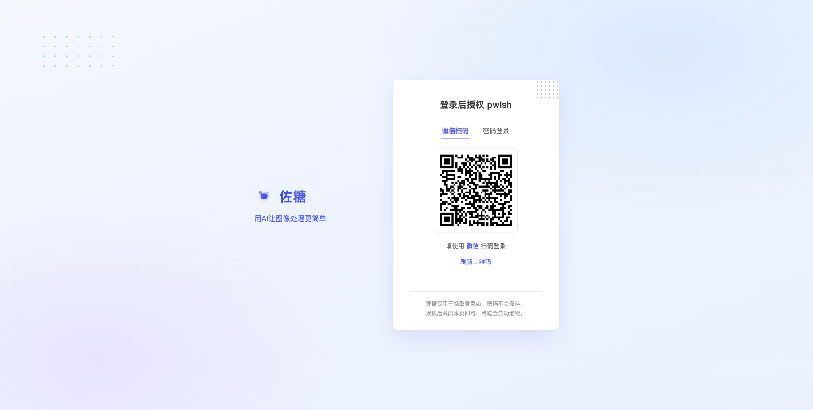
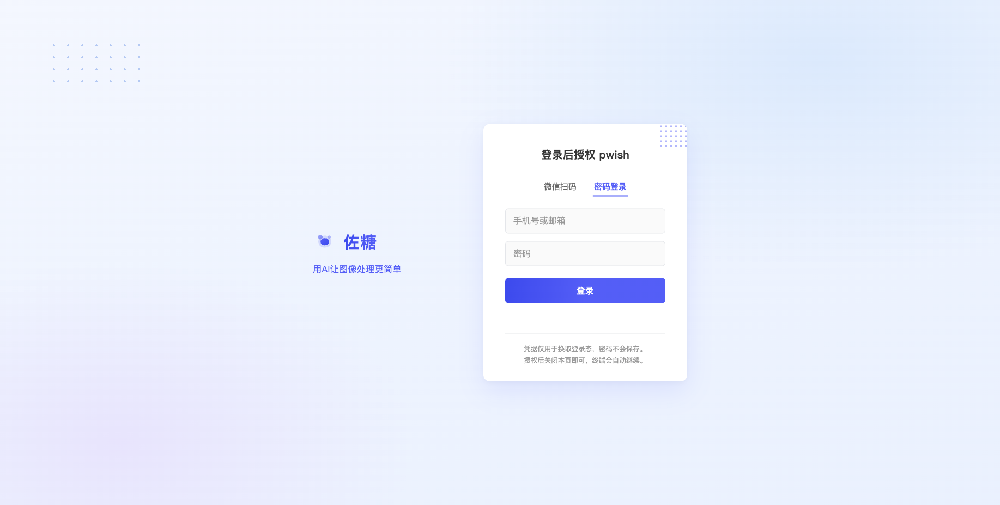

# pwish

**佐糖 AI 设计师的官方账号登录 + 命令行出图工具。** 一句话出电商图、商品图成套出图，结果自动下载到本地。

<p>
  <a href="https://www.npmjs.com/package/pwish-cli"></a>
  <a href="https://www.npmjs.com/package/pwish-cli"></a>
  <a href="https://github.com/MisonL/pwish-cli/actions"></a>
  
  <a href="LICENSE"></a>
</p>

```bash
npm i -g pwish-cli
pwish login                                   # 本机登录页，微信扫码或账号密码
pwish gen "白底商品图，柔和影棚光" -i ./mug.jpg   # 出图并自动下载
pwish suite -i ./mug.jpg --selling "白瓷马克杯 350ml" --scenes main,selling
```

> 非官方工具：账户额度的消耗、图片水印与内容合规规则由佐糖账号与站点政策决定。

## 目录

- [安装](#安装) · [登录](#登录) · [会员与额度反馈](#会员与额度反馈) · [命令](#命令) · [例子](#例子)
- [模型](#模型) · [接口说明](#接口说明随站点更新可能变化) · [Skill](#skill)
- [开发与测试](#开发与测试) · [已知限制](#已知限制)

## 特性

| | |
|---|---|
| **本机登录页** | 微信扫码 / 手机号邮箱密码，视觉与官网一致，凭据不落盘 |
| **一句话出图** | 支持参考图、模型、比例、清晰度、张数与经济/稳定模式 |
| **电商套图** | 商品图 → AI 写场景提示词 → 白底/卖点/材质/模特成套出图 |
| **电商详情图** | 商品图 + 卖点 → 海报/亮点/卖点/细节/生活/多场景/尺寸模块图 |
| **图片工具** | 抠图、变清晰、高清修复、图像扩展、图片翻译、AI 换背景、去水印、去杂物、上色、格式转换 |
| **批量处理** | 对一个目录里的图片批量跑同一个工具或批量生图，逐张报告成败 |
| **结果管理** | 任务查询、历史会话、队列状态、过期链接重下 |
| **零依赖** | 只用 Node 内置模块，含 LevelDB/Snappy 与 PKCE 的自实现 |

## 安装

从 npm 安装（推荐）：

```bash
npm i -g pwish-cli
pwish --version
```

无需登录 npm；Node.js ≥ 20（使用内置 `fetch`）。**无第三方运行时依赖。**

也可以免安装直接运行：`npx -y pwish-cli --version`。

### 安装 agent skill

skill 已随 npm 包一起发布，**不需要单独下载仓库**：

```bash
pwish skill --install    # 安装到 ~/.agents/skills/pwish/SKILL.md
```

其它用法：

| 命令 | 作用 |
|---|---|
| `pwish skill` | 查看安装说明 |
| `pwish skill --install --dir <技能根目录>` | 安装到 `<技能根目录>/pwish/`（如 `--dir ~/.codex/skills`） |
| `pwish skill --showpath` | 打印内置 skill 文件路径 |
| `pwish skill --print` | 直接输出 SKILL.md 内容 |

如果 agent 从其他技能目录加载（如 `~/.codex/skills/`），用 `--dir` 指向那个技能根目录即可，
CLI 会自动在其中创建 `pwish/` 子目录；`--dir` 已经以 `pwish` 结尾时则直接写入该目录。

## 开发与测试

```bash
npm run verify   # = npm run check + npm test（CI 同一套）
npm run check    # 自检：语法 / 未使用 import / 硬编码凭证 / 输出层规范
npm test         # node --test，42 个用例
npm run test:watch
```

测试覆盖：模型 payload 分族构造、套图结果解析、配置与 token 解析、参数解析、
OAuth 授权码/PKCE/CSRF/Host 防护、Snappy 解压与 varint 解码、CLI `--version`。
**测试不产生任何 API 请求、不消耗额度。** CI（`.github/workflows/ci.yml`）在 Node 20 / 22 上跑同一套。

| 文件 | 职责 |
|---|---|
| `src/api.js` | 同源接口客户端（Bearer、错误码映射、超时） |
| `src/upload.js` | OSS STS 上传（V1 签名 + `x-oss-callback` 换 resource_id） |
| `src/tasks.js` | 建会话 / 建任务 / 批量轮询 / 下载 / 历史 / 队列 |
| `src/suite.js` | 电商套图两步流程（AI 写提示词 → 批量出图） |
| `src/models.js` | **模型表、比例尺寸表、场景表、payload 构造（改版时的主要改点）** |
| `src/auth-server.js` | 本机授权服务：登录页 + OAuth 授权码 + PKCE |
| `src/passport.js` | 官方账号登录接口客户端（扫码 / 密码） |
| `src/login-page.js` | 自建登录页与结果页（对齐官网视觉） |
| `src/args.js` / `src/output.js` | 参数解析 / 输出与着色（stdout/stderr 分离） |
| `src/cli.js` | 命令路由与业务编排 |
| `scripts/check.js` | 零依赖静态自检 |
| `test/` | 单元与 CLI 冒烟测试 |

版本与变更记录见 `CHANGELOG.md`；许可证见 `LICENSE`（MIT + 非官方工具免责声明）。

## 登录

```bash
pwish login
```

命令会在本机 `127.0.0.1` 启动一个**自建登录页**并自动打开浏览器。视觉对齐佐糖官网登录页：

| 微信扫码 | 密码登录 |
|---|---|
|  |  |

支持两种方式：

- **微信扫码**：页面直接展示官方生成的二维码，手机上确认即可；
- **密码登录**：手机号或邮箱 + 密码。

登录凭据只交给本机服务，由它调用官方账号接口换取登录态，密码不保存、不外传。
拿到登录态后页面提示「授权完成」，终端自动继续。

### 为什么是本机页面

网页端的登录态只能由官方接口签发。为了让 CLI 也能正当地登录，本机起了一个临时授权服务，
页面视觉与佐糖官网登录页一致（品牌紫蓝渐变、白卡片、相同输入框规格），
底层复用官方登录接口，不接触任何第三方：

1. `pwish login` 起服务，生成 `state` 与 PKCE(S256) 参数，打开授权页；
2. 用户在页面上登录 → 本机服务调用官方接口换取 `api_token`；
3. 服务签发一次性授权码（60 秒、单次使用），页面跳回 `/callback`；
4. CLI 校验 `state` 与 PKCE 后收下 token，写入配置。

### 其他入口

| 命令 | 场景 |
|---|---|
| `pwish login --no-open` | 不自动开浏览器，只打印授权链接（远程/SSH） |
| `pwish login --port 8765` | 指定回环端口（默认随机） |
| `pwish login --token 'v2,...'` | CI / 无浏览器环境直接给 token |
| `pwish login --paste` | 从剪贴板读 token |
| `pwish whoami` / `pwish quota` / `pwish logout` | 账号 / 额度 / 退出 |

安全设计：
- 只 `listen` 在 `127.0.0.1`，校验 `Host` 头，防 DNS rebinding；
- `state` 防 CSRF 且一次性；PKCE S256 把授权码绑死在本客户端；
- 授权码一次性、60 秒过期；token 只经 POST body 与内存传递，不进 URL、不进日志；
- 密码只在一次请求中透传给官方接口，不落盘；
- 凭证存 `~/.config/pwish/config.json`，权限 `0600`。

环境变量：

| 变量 | 作用 |
|---|---|
| `PWISH_TOKEN` | 临时覆盖 token |
| `PWISH_OUT` | 默认输出目录 |
| `PWISH_API_BASE` | 覆盖接口域名（默认 `https://aw.aoscdn.com/app/picwish`） |
| `PWISH_PASSPORT_BASE` | 覆盖账号登录接口域名 |
| `PWISH_CONFIG_DIR` | 覆盖配置目录 |
| `PWISH_DEBUG` | 出错时打印原始响应/堆栈 |
| `PWISH_QUIET` | 等价于 `--quiet`：只输出结果行 |


## 会员与额度反馈

CLI 对会员、算粒、免费额度的处理是「先看再跑、跑完回读」：

- `pwish quota` 一次看全：账号身份（免费 / 会员 + 到期 + 算粒）、各生图模型免费次数、
  设计任务（套图 / 详情图 / AI 图片编辑）、图片工具（抠图 / 变清晰 / 高清修复 / 图像扩展 /
  图片翻译 / 换背景 / 去水印 / 去杂物 / 上色 / 格式转换）。有「今日已用」计数的项目会一并显示。
- **生成前预检**：`gen` / `suite` / 各图片工具在提交前查一次额度。目标额度为 0 时直接拦下并给出可选项，
  例如 `模型 gemini-3：免费次数已用完，可换用还有额度的模型：jimeng-5-flash(3)、gemini-3.1(1)`。
- **跑完回读**：任务结束会打印一行额度，并说明本次到底有没有扣：
  `额度：图片翻译 当前计数 6 次（本次 消耗 1）`、`额度：抠图去背景 当前计数 10 次（站点计数未变化）`。
  第二句不是 bug——抠图这类计数本来就不随调用变化。
- **强制提交**：账号确实还有会员权益、但 CLI 把额度判成 0 时，加 `--force` 跳过预检。
- **错误码可执行**：`CREDIT_NOT_ENOUGH` / `DAILY_LIMIT_EXCEEDED` / `FREE_PREVIEW_LIMIT_EXCEEDED`
  都会说明「能做什么」（换模型、次日重置、升级会员），而不只是一个数字。

额度数据来自 `GET vips/all-free-counts`，字段语义按站点功能对应；无法确认的字段不猜，
在表里显示为 `—`。

`pwish batch` 会在开跑前用当前工具的剩余额度做一次校验：待处理张数超过剩余次数时直接拦下，
避免跑到一半才发现额度不够。

**额度什么时候恢复？**

站点文案把免费额度写成「每日免费下载权益」，但**实测这些计数并不都按天回补**，因此 CLI 不承诺「次日恢复」：

| 观察 | 数据 |
|---|---|
| 跨天后翻译额度 | 7 → 7（未回补） |
| 跨天后扩图额度 | 0 → 0（未回补） |
| 抠图额度 | 连续成功调用 5 次以上，数值始终 10（不随调用变化） |
| `segmentation_used_free_num` | 跨天从 2 归 0，但当天再跑一次抠图仍为 0（不随调用变化） |

结论：这些字段混着「当日发放量」「一次性试用余量」等不同口径，接口里也没有下发重置时间戳。
CLI 只做两件事：把非 0 视为可用、把 0 视为不可用；恢复时机以站点实际表现为准。
真正带 `DAILY_LIMIT_EXCEEDED`（15030）的报错才是明确的服务端每日限制。

## 命令

```bash
pwish whoami                          # 当前账号：会员身份 + 算粒
pwish quota                           # 额度总览：生图模型 / 设计任务 / 图片工具
pwish quota --json                    # 机器可读，含会员到期与算粒字段
pwish models                          # 模型 / 比例 / 清晰度表

pwish gen "提示词" -i 参考图 [-m 模型] [-r 比例] [-s 2K] [--mode economy|stable] [-n 张数] [-o 目录]
pwish suite -i 商品图 [--selling "卖点"] [--site amazon] [--scenes main,core,selling,material,person]
pwish detail -i 商品图 --selling "卖点" [--scenes poster,highlights,feature,detail]

pwish cutout ./photo.jpg              # 抠图 → 透明底 PNG
pwish upscale ./photo.jpg [--type photo|general|text] [--scale 2]
pwish restore ./photo.jpg             # 高清修复（模糊 / 低清 / 老照片）
pwish expand ./photo.jpg --to 16:9    # 图像扩展：自动算四边外扩量
pwish translate ./poster.jpg --to ENG # 图片翻译：保留版式替换文字
pwish batch cutout ./photos -o out/cut   # 批量抠图（目录里所有图片）
pwish batch gen ./photos --prompt "白底商品图"   # 批量生图
pwish bg ./product.jpg --prompt "白色大理石台面"
pwish dewatermark ./photo.jpg
pwish erase ./photo.jpg --mask ./mask.png [--strength 3]
pwish colorize ./bw-photo.jpg
pwish convert ./photo.png --format jpg|png|webp|bmp|gif

pwish history [--limit 20]
pwish show <conversation_id>
pwish task <id> [...]                    # 对话任务 / 套图 / 详情图 / 会话 id 都能查
pwish download <id> [-o 目录]           # 同上，三种 id 都可重新下载
pwish queue
```

全局开关：`--json`（机器可读）、`-o/--out`（输出目录，默认 `out/`）、`--version`（版本号）。

`--mode` 支持 `economy`（默认）与 `stable`；**`stable` 参数会正确下发但尚未实测**出图效果与计费差异。

## 例子

```bash
# 白底主图
pwish gen "纯白色背景，商品居中占画面85%，柔和影棚光，高细节" -i ./mug.jpg -m gpt-image-2 -r 1:1 -s 2K

# 电商套图：亚马逊，5 个可用场景里的 3 个
pwish suite -i ./mug.jpg --selling "简约白瓷马克杯 350ml，可微波加热" \
  --site amazon --scenes main,selling,material

# 电商详情图：海报 + 卖点 + 细节 三个模块
pwish detail -i ./mug.jpg --selling "简约白瓷马克杯 350ml，可微波加热" \
  --site amazon --scenes poster,feature,detail -o out/detail

# 一次出 3 张备选
pwish gen "白底商品图，柔和阴影" -i ./mug.jpg -n 3 -o out/v1

# 竖图改成 16:9 横版（电商主图 / 详情页头图）
pwish expand ./mug.jpg --to 16:9 -o out/wide

# 一个目录里的商品图全部抠成透明底
pwish batch cutout ./photos -o out/cut --concurrency 2

# 同一套提示词，给每张商品图各出一张图
pwish batch gen ./photos --prompt "白底商品图，柔和影棚光" -m nano-banana-pro -o out/gen

# 每张图配不同提示词：每行对应一张，顺序与文件名排序一致
pwish batch gen ./photos --prompt-file prompts.txt -o out/gen

# 中文海报换成英文版（文字替换，版式保留）
pwish translate ./poster.jpg --from CHS --to ENG -o out/en
# 注意：--from auto 服务端不支持（会 task failed），要按实际语种传 CHS / ENG 等

# 商品图：抠透明底 → 换场景背景
pwish cutout ./mug.jpg -o out/cut
pwish bg ./mug.jpg --prompt "浅灰水泥台面，右侧窗光，浅景深" -o out/bg

# 老图修复三连：变清晰 → 上色 → 去水印
pwish restore ./old.jpg -o out/fix
pwish colorize ./old.jpg -o out/fix
pwish dewatermark ./old.jpg -o out/fix
```

## 模型

| key | id | 说明 |
|---|---|---|
| `gemini-3` | 6 | 电商模型 3.0（最强，10-20 算粒/张） |
| `nano-banana-pro` | 72 | 电商模型 2.0 |
| `nano-banana-2-lite` | 61 | 电商模型 1.0（最便宜） |
| `gpt-image-2` | 195 | GPT Image 2（补贴通用模型，3-5 算粒/张） |
| `gpt-image-2-flare` | 89 | GPT Image 2 Flare |
| `gpt-image-1.5` | 190 | GPT Image 1.5 |
| `gpt-image-1` | 83 | GPT Image 1 |
| `gemini-2.5` | 154 | Gemini 2.5 Flash Image |
| `seedream-5-pro` / `-flash` / `5.5` | 78 / 79 / 94 | Seedream 系列 |
| `jimeng-4.5` | 41 | 即梦 4.5 |
| `flux` | 1 | FLUX |

比例：`auto 1:1 2:3 3:2 3:4 4:3 9:16 16:9`；清晰度：`1K 2K 2K+`（→ standard/high/super）。

### 场景（`--scenes`）

电商套图支持 5 个场景，均已实测：`main`(白底主图) `core`(核心卖点图) `selling`(卖点图) `material`(材质图) `person`(模特展示图)。
站点 UI 还有「场景展示图」「多场景拼图」两个选项，其接口参数尚未确认，CLI 暂不支持。

## 接口说明（随站点更新可能变化）

基址 `https://aw.aoscdn.com/app/picwish`，`Authorization: Bearer <passport_api_token>`，
所有请求带 `product_id=482&language=zh`。

| 用途 | 接口 |
|---|---|
| 额度 | `GET vips/all-free-counts` |
| 建会话 | `POST image/conversations` |
| 一句话出图 | `POST tasks/login/image-messages` |
| 批量查任务 | `GET tasks/login/image-messages/batch?task_ids=` |
| 队列 | `GET image/conversations/task-queue` |
| 会话列表/详情 | `GET image/conversations`、`GET image/conversations/{id}` |
| 套图：AI 写提示词 | `POST tasks/login/suite/prompt` → `GET tasks/login/suite/prompt/{task_id}` |
| 套图：出图 | `POST tasks/login/suite` → `GET tasks/login/suite/{task_id}` |
| 套图：推荐场景 | `POST tasks/login/suite/recommend` → `GET tasks/login/suite/recommend/{task_id}` |
| 详情图：写提示词 | `POST tasks/login/suite/prompt`（`from=detail-custom-prompt`） |
| 详情图：出图 | `POST tasks/login/suite`（`from=design-detail`，结果按场景放在 `items`） |
| 抠图 | `POST tasks/login/segmentation` → `GET tasks/login/segmentation/{task_id}` |
| 变清晰 | `POST tasks/login/scale` → `GET tasks/login/scale/{task_id}` |
| 高清修复 | `POST tasks/login/scale-pro` → `GET tasks/login/scale-pro/{task_id}` |
| 图像扩展 | `POST tasks/login/self-image-expand` → `GET tasks/login/self-image-expand/{task_id}` |
| 图片翻译 | `POST tasks/login/external/image-translate` → `GET tasks/login/external/image-translate/{task_id}` |
| AI 换背景 | `POST tasks/login/background` → `GET tasks/login/background/{task_id}` |
| 去水印 | `POST tasks/login/auto-watermark-image` → `GET tasks/login/auto-watermark-image/{task_id}` |
| 去杂物 | `POST tasks/login/object-refine` → `GET tasks/login/object-refine/{task_id}` |
| 上色 | `POST tasks/login/colorization` → `GET tasks/login/colorization/{task_id}` |
| 格式转换 | `POST tasks/image-conversion` → `GET tasks/image-conversion/{task_id}` |
| 上传授权 | `POST authorizations/oss`（STS，随后 PUT 到 OSS 带 `x-oss-callback` 换 `resource_id`） |

生成结果轮询到 `state=1`（或 `progress=100`）后，`answer[].file` 即图片 URL（OSS 签名约 2 小时有效）。

## Skill

`skill/pwish/SKILL.md` 是为 agent 准备的用法协议（额度预检、模型选择、套图配方、错误码处理、提示词方法论），
已随 npm 包一起发布。安装方式见上文「安装 agent skill」，最简单的是：

```bash
pwish skill --install
```

## 已知限制

**能力边界**（没做 / 没验证，不要当成能用）：

- **视频生成未实现**：接口存在（`tasks/login/video-messages`），账号无视频额度，未能实测，因此没有封装。
- **套图场景 5/7**：见上文「场景」，「场景展示图」「多场景拼图」不支持。
- **`--mode stable` 未实测**：参数正确下发，但只验证过 `economy`。
- **换背景需要提示词**：`pwish bg` 先用抠图得到透明底，再调背景生成；一次返回 1-4 张候选。
- **去杂物需要蒙版**：`pwish erase` 的 `--mask` 是标注擦除区域的图，CLI 不做画布交互。
- **上传单文件上限 20MB**（CLI 侧保护）。实际站点限制未逐一验证。

**产品与环境限制**：

- 免费额度生成的图片**带水印**（URL/文件名含 `-wm_`）；去水印需按站点规则付费。
- 结果图片 URL 是签名链接（约 2 小时），过期需用 `pwish download` 重新拉（会自动重新查询拿新签名）。
- 接口无公开文档，字段以实测为准；站点改版可能导致失效，`src/models.js` 是模型/比例/场景的单一改点。
